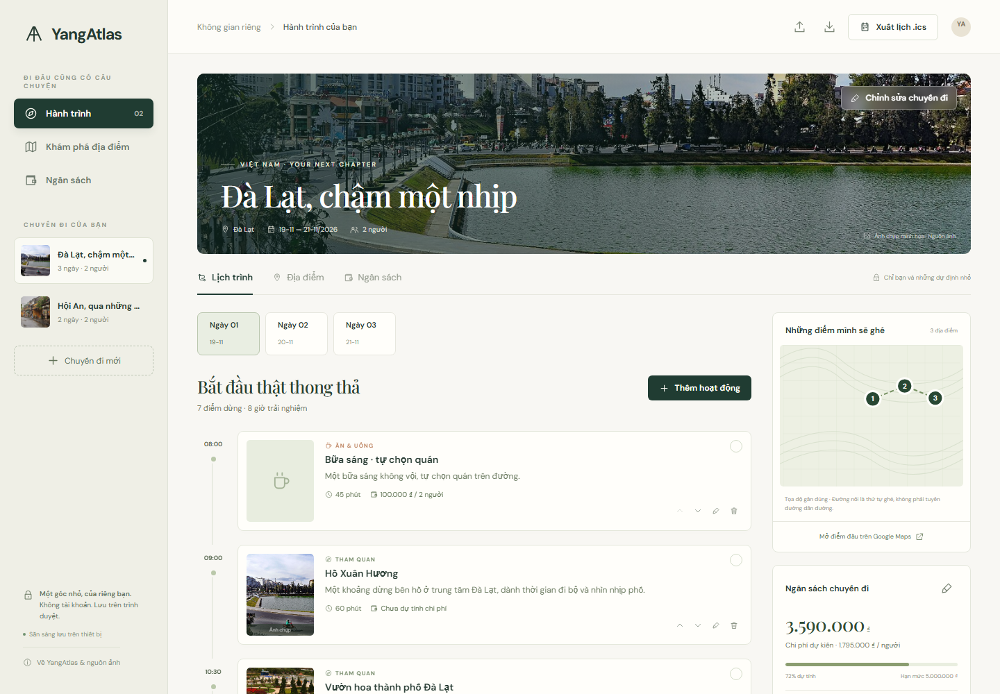

# YangAtlas

**Mỗi chuyến đi, một câu chuyện.**

A quiet travel-planning workspace for visual day-by-day itineraries, editable
budgets and calendar export. Designed in Vietnamese with an editorial layout,
warm paper tones, pine green and genuine destination photography.

**[Open Live Demo →](https://nguyenhonggiang2407.github.io/YangAtlas/)** · [Verified CI](https://github.com/nguyenhonggiang2407/YangAtlas/actions/runs/41944144524) · [Photography credits](docs/MEDIA.md)

Public deployment verified on **5 November 2026**, including browser-local editing,
reload, real JSON/ICS downloads, desktop/mobile photographs and exact source hashes.



## Use the product

- Start with the Đà Lạt or Hội An example, or create your own trip to either
  supported destination. Choose dates, 1–14 days, 1–20 travelers and a VND budget.
- Search the curated place library, filter by category and add a place to a day.
  Add your own meals, accommodation, transfers or other activities as well.
- Edit times, duration, notes and costs. Move neighboring activities earlier/later;
  the schedule updates while retaining each duration. Time overlaps are flagged.
- Track per-person and whole-group estimates, compare them with your budget and
  mark a stop as visited. Removing an activity has an undo action that preserves
  other changes made after removal.
- Export a complete JSON backup and restore only after validation and confirmation.
  Export an RFC 5545 calendar with Unicode-safe line folding and midnight rollover.
- Data stays in the browser's local storage. There is no login, backend, AI API,
  payment processing or cloud synchronization. Fonts and photographs are bundled.

The two example itineraries contain fictional costs and durations. They are not
current prices, booking offers or verified package tours. The map is a schematic
of approximate coordinates, not a navigation route. Some cards reuse a clearly
labeled destination photograph. See [photography and place sources](docs/MEDIA.md).

## Run locally

Requires Node.js 24 or newer. Runtime has **zero third-party JavaScript dependencies**.
Playwright is a development-only dependency for browser tests.

```sh
npm ci
npm run dev
```

Open the Local URL printed by the server, normally `http://127.0.0.1:4177/`.

```sh
npm run check
npm test
npm run build
npx playwright install chromium
npm run test:browser
```

`npm run build` copies the source and public assets to `dist/`; it does not embed
credentials or require an external API. All runtime paths are relative, including
fonts, so the application works below a GitHub Pages repository subpath.

## Structure

| Path                              | Responsibility                                                        |
| --------------------------------- | --------------------------------------------------------------------- |
| `src/app.js`                      | Accessible UI, dialogs, browser storage, safe rendering and downloads |
| `src/domain.js`                   | Pure validation, dates, money, overlaps, reorder and ICS rules        |
| `src/catalog.js`                  | Curated places and clearly fictional example itineraries              |
| `src/styles.css`, `src/fonts.css` | Responsive visual system and self-hosted typography                   |
| `public/`                         | Licensed photography, fonts and original favicon                      |
| `tests/`                          | Native Node domain checks and real browser workflows                  |
| `scripts/`                        | Static build, asset integrity and local preview                       |

See [architecture and data rules](docs/ARCHITECTURE.md),
[validation evidence](docs/VALIDATION.md) and [third-party notices](THIRD_PARTY_NOTICES.md).

## Practical limits

Local storage is per origin, browser and device. Export backups before clearing
browser data or switching devices. Storage denial/quota failure is shown explicitly;
the planner remains usable in memory. Invalid stored data is preserved rather than
silently overwritten. An initial page load needs connectivity; no service-worker
offline installation or cross-device synchronization is promised.

JSON imports are limited to 1 MiB, 10 trips and 100 activities per trip. Imported
values are reconstructed and validated; malformed or empty workspace backups do
not replace the existing planner. Current UI destinations are Đà Lạt and Hội An.
Calendar files use floating local times, so the receiving calendar's timezone
matters. Check your calendar after import.

Meals, accommodation and transport not connected to a curated place are editable
placeholders. The app does not calculate travel times, guarantee opening hours,
live conditions or entry arrangements, or include costs you have not entered.

## License and provenance

Original application code: [MIT](LICENSE). Photos retain their individual Creative
Commons licenses; self-hosted fonts retain SIL OFL. Attribution and source hashes
are in [THIRD_PARTY_NOTICES.md](THIRD_PARTY_NOTICES.md). Development used AI-assisted
coding; there are no claimed users, testimonials or invented development history.
