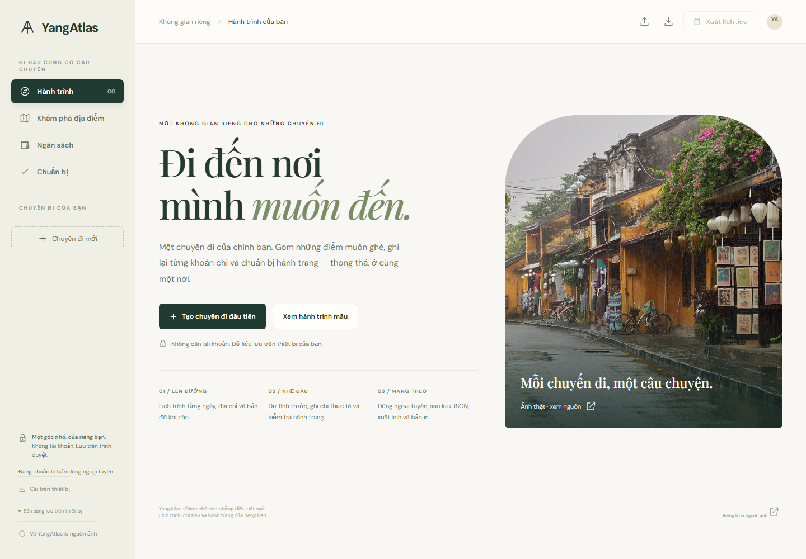
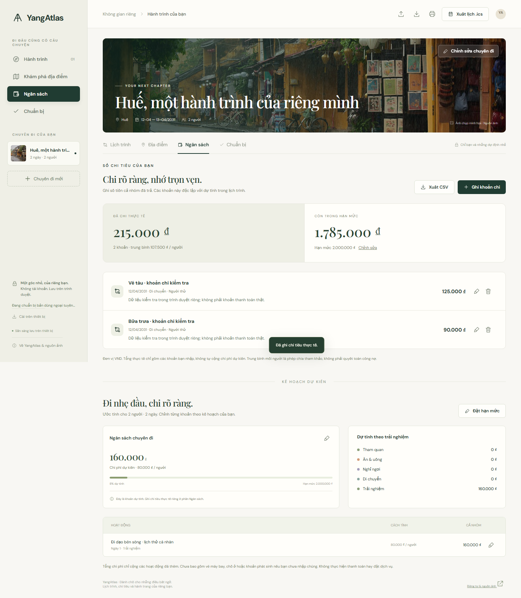
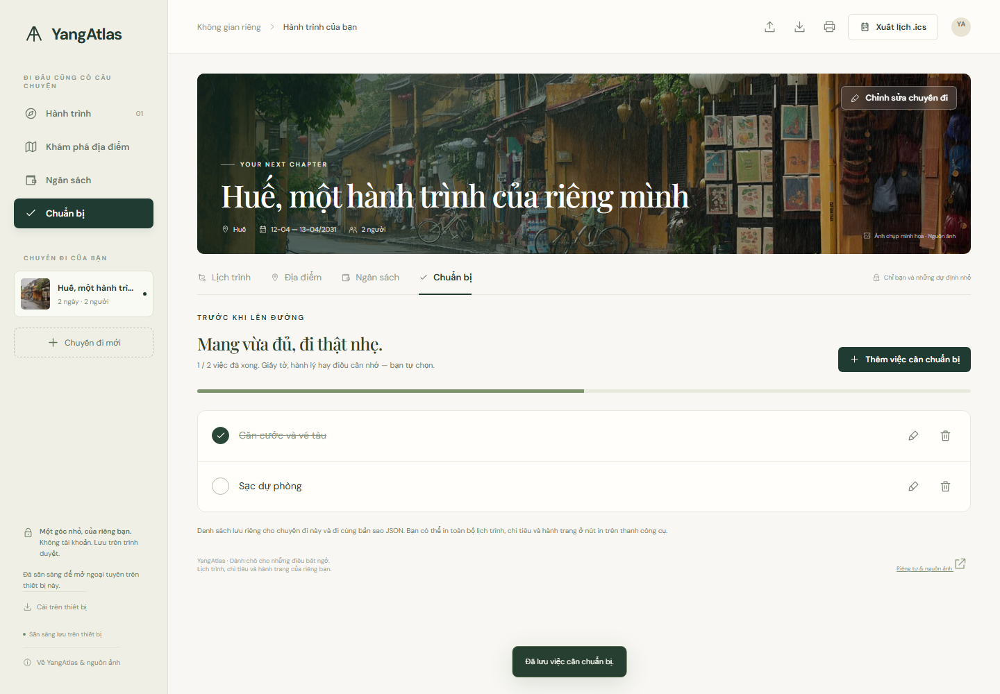

# YangAtlas

**Mỗi chuyến đi, một câu chuyện.**

A personal travel planner for real itineraries, actual expenses and the little
things to pack. Vietnamese interface, warm paper tones, pine green and licensed
destination photography. No account required.

**[Open YangAtlas →](https://nguyenhonggiang2407.github.io/YangAtlas/)** · [Build & browser checks](https://github.com/nguyenhonggiang2407/YangAtlas/actions/workflows/pages.yml) · [Photography credits](docs/MEDIA.md)



Verified public release **5 November 2026**: [40 native checks + 17 browser workflows](https://github.com/nguyenhonggiang2407/YangAtlas/actions/runs/41951152367), 32 exact public-file hashes and real offline edits/reload. [Detailed evidence](docs/VALIDATION.md).

<details>
<summary>Actual expense ledger and preparation checklist</summary>




These are direct screenshots with isolated verification data, not real purchases or customer records.
</details>

## Make it your own

- **Start with your own trip.** Enter any destination, dates, 1–90 days, up to
  100 travelers and a VND budget. Example Đà Lạt / Hội An journeys are optional;
  they are never inserted into a new workspace automatically.
- **Plan every day.** Add your own stops, addresses, meals, transfers and lodging.
  Edit time, duration, cost and notes, mark visits complete, swap neighboring
  activities and see time conflicts. Open each address on Google Maps when needed.
- **Record what you actually paid.** A separate expense ledger tracks date,
  amount, category, payer and notes. Actual spending and itinerary estimates stay
  separate. Edit or undo deletions; export the ledger as a UTF-8 CSV.
- **Prepare calmly.** Maintain a checklist for each trip and tick off completed
  tasks. Trip edits preserve activities, expenses and preparation items.
- **Take it along.** After the app reports offline readiness, reopen it and edit
  trips without a network connection. Install through a supported browser, export
  a Unicode-safe ICS calendar, or print a complete itinerary, ledger and checklist.
- **Keep control of your data.** Export/import JSON backups with confirmation and
  atomic validation. Version 1 backups migrate to version 2 without discarding
  old trips. Empty workspaces are valid. Conflicting changes from another tab,
  corrupt data and denied/full storage are shown explicitly.

Fonts, photos and application code are self-hosted. There is no analytics, AI API,
server database, login, payment processing or cloud synchronization. Map queries
only leave the app when you choose a Google Maps link.

## Run locally

Requires **Node.js 24+**. There are **zero third-party JavaScript runtime
dependencies**; Playwright is used only for development checks.

```sh
npm ci
npm run dev
```

The preview URL is printed by the server, normally `http://127.0.0.1:4177/`.
The raw source preview does not install an offline release. To preview the
generated offline application, build it first and use `npm run preview`.

```sh
npm run check
npm test
npm run assets:check
npm run build
npx playwright install chromium
npm run test:browser
```

The deterministic build writes `dist/`, derives an integrity-checked offline
cache from the actual file bytes, and needs no external API or credentials.
Relative paths support GitHub Pages repository subpaths. The workflow verifies
the app before publishing the static artifact to the existing free Pages site.

## Data, privacy and practical limits

Data belongs to the current origin, browser and device. Installation does not
sync it. Export a JSON backup before clearing browser data or changing devices;
browser storage can still be removed by the browser or operating system.
Storage failures leave the current edits in memory with an explicit warning.
Corrupt stored content and conflicting tabs are not silently overwritten.

Offline use requires an initial successful online build download and a browser
that supports service workers. Updates wait for acceptance or for previous tabs
to close; the app never silently reloads an open form. External maps and source
links require connectivity. The planner does not calculate travel times, resolve
addresses automatically, verify opening hours, sell trips or fetch live prices.

Backups: 4 MiB, 50 trips, 500 activities / expenses / checklist items per trip.
Amounts are integer VND. Expenses can be recorded before or after the itinerary
dates. The per-person figure is a simple average, not a debt settlement.
CSV text cells that resemble spreadsheet formulas are prefixed on export;
spreadsheet re-saving behavior varies. Calendars use floating local times, so
check the receiving calendar's timezone after import.

The two optional sample itineraries contain fictional costs and durations. The
curated library covers Đà Lạt and Hội An; your own destinations and addresses are
unrestricted. Cover photos are explicitly illustrative scenery and retain their
real locations and attribution. They do not claim to depict a custom destination.

## Source and verification

| Path                                         | Responsibility                                                           |
| -------------------------------------------- | ------------------------------------------------------------------------ |
| `src/app.js`                                 | UI, local storage, dialogs, print and downloads                          |
| `src/domain.js`                              | Schema migration, strict validation, dates, budgets, ledger, CSV and ICS |
| `src/offline.js`, `public/service-worker.js` | Offline lifecycle and deliberate updates                                 |
| `src/catalog.js`                             | Curated venues and optional example itineraries                          |
| `src/styles.css`, `src/fonts.css`            | Responsive design and self-hosted typography                             |
| `tests/`                                     | Domain, offline-build and real browser workflows                         |
| `scripts/`                                   | Deterministic static build, integrity checks and local preview           |

See [architecture](docs/ARCHITECTURE.md), [validation evidence](docs/VALIDATION.md)
and [third-party notices](THIRD_PARTY_NOTICES.md).

Original application code: [MIT](LICENSE). Photographs retain their Creative
Commons licenses and fonts retain SIL OFL. Source hashes and credits are preserved
in the repository and published artifact. Development used AI-assisted coding;
there are no invented users, testimonials, screenshots or development history.
