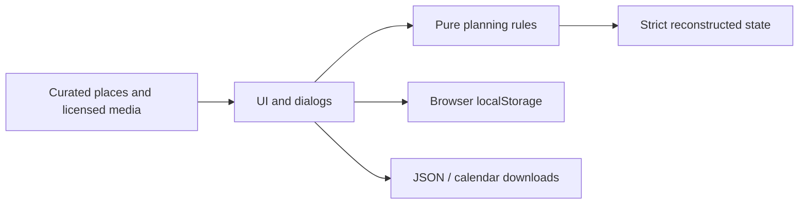

# Architecture and data rules

YangAtlas is a static browser application. The user interface delegates data rules
to a DOM-independent module; there is no server and no runtime JavaScript library.

## Data boundaries

The stored envelope is version 1 with activeTripId and up to10 trips. Trips contain
dates, duration in days, traveler count, a total VND budget and activities. Activities
store a start time, integer minutes, integer VND cost, per-person or group scope,
category, completion state, notes and an optional curated place ID. Photos are
resolved from a bundled catalog, never from an imported URL.

The domain reconstructs objects using only known fields. It rejects unexpected
prototypes/accessors, invalid Unicode/control characters, duplicate IDs, invalid
calendar dates, unsafe integers and out-of-range values. Browser imports also
require at least one trip before changing either state or storage. The domain can
represent an empty state for other consumers; the current UI deliberately cannot.

User strings are escaped before rendering. Downloads use fixed filenames and Blob
URLs. Import is size-limited and validated before the confirmation dialog. Cancellation
or a failed validation does not mutate current data. A malformed persisted snapshot
is retained; in-memory planning can continue and a deliberate valid import can replace it.

## Time and budget semantics

Dates are calendar dates, not implicit UTC timestamps. UTC arithmetic is used only
as a stable date counter to avoid local timezone drift. Activity durations may span
midnight; overlap detection includes intervals from the previous day. Adjacent reorder
keeps durations and positive spacing and refuses changes extending past midnight.

Budget totals multiply per-person costs by the traveler count and add group costs
once. The displayed average is rounded for reading; the domain retains the numeric
average. A zero budget has a zero percentage, rather than division by zero. Over-budget
amounts are retained even when the progress bar is capped visually at100%.

Calendar export follows [RFC 5545](https://www.rfc-editor.org/rfc/rfc5545.html):
CRLF,75-octet UTF-8 folding without broken code points, escaped text and stable
event UIDs. DTSTAMP uses the real export instant; an injected clock supports tests.
DTSTART/DTEND are floating local times, deliberately without an implied timezone.

## Privacy and deployment

Static assets and fonts are served from the same origin. The app sends no itinerary
to a backend, analytics service or model provider. A user-selected map or source link
opens a third-party website. Hosting providers still receive ordinary page requests.

GitHub Pages receives only the generated dist artifact after checks pass. Pull
requests run verification without a deployment permission. The optional Sites
copy remains owner-private; its opaque project ID is configuration, not a secret.
Credentials are not committed. Production tests must use their own browser context,
so they never replace another visitor's saved planner.
