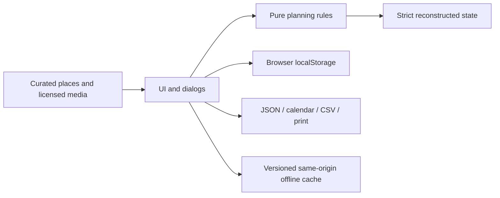

# Architecture and data rules

YangAtlas is a static browser application. The user interface delegates data rules
to a DOM-independent module; there is no server and no runtime JavaScript library.

## Data boundaries

The stored envelope is version 2 with activeTripId and up to 50 trips. Version 1
snapshots migrate without changing their identifiers, dates, values or content;
new address, expense and checklist fields start empty. The storage key is retained
so an update finds existing records. Empty workspaces are valid. Trips contain
dates, duration in days, traveler count, a total VND budget and activities. Activities
store a start time, integer minutes, integer VND cost, per-person or group scope,
category, completion state, address, notes and an optional curated place ID.
Destinations are user-entered text, while photos are
resolved from a bundled catalog, never from an imported URL.

The domain reconstructs objects using only known fields. It rejects unexpected
prototypes/accessors, invalid Unicode/control characters, duplicate IDs, invalid
calendar dates, unsafe integers and out-of-range values. Backups are limited to
4 MiB, 90-day trips, 100 travelers and 500 activities, expenses and checklist items
per trip. Collections require unique identifiers within each type.

User strings are escaped before rendering. Downloads use fixed filenames and Blob
URLs. Import is size-limited and validated before the confirmation dialog. Cancellation
or a failed validation does not mutate current data. A malformed persisted snapshot
is retained; in-memory planning can continue and a deliberate valid import can replace it.
Before writing, the UI compares the actual stored snapshot with the last one it
read or wrote. A change from another tab protects that content and warns the
visitor to export the current in-memory edits before reopening. Storage events
surface the same conflict without removing an open form.

## Time and budget semantics

Dates are calendar dates, not implicit UTC timestamps. UTC arithmetic is used only
as a stable date counter to avoid local timezone drift. Activity durations may span
midnight; overlap detection includes intervals from the previous day. Adjacent reorder
keeps durations and positive spacing and refuses changes extending past midnight.

Budget totals multiply per-person costs by the traveler count and add group costs
once. The displayed average is rounded for reading; the domain retains the numeric
average. A zero budget has a zero percentage, rather than division by zero. Over-budget
amounts are retained even when the progress bar is capped visually at100%.

The expense ledger is separate from estimated activities. It sums integer amounts
once for the whole group, regardless of traveler count. Dates can be outside the
itinerary to support advance purchases. Payer names are annotations; there is no
debt allocation. CSV uses BOM, CRLF, quoted cells and doubled quotation marks.
Formula-looking text is prefixed with an apostrophe on export without modifying
the source data; no claim is made about every spreadsheet's re-save behavior.

Trip duplication creates fresh identifiers for the new trip, activities and
checklist items. It preserves the reusable itinerary and day positions, accepts a
new start date, resets completion flags and clears actual expenses. It does not
change the original trip or carry previous payments into the new ledger.

Calendar export follows [RFC 5545](https://www.rfc-editor.org/rfc/rfc5545.html):
CRLF,75-octet UTF-8 folding without broken code points, escaped text and stable
event UIDs. DTSTAMP uses the real export instant; an injected clock supports tests.
DTSTART/DTEND are floating local times, deliberately without an implied timezone.
User-entered addresses are escaped and folded into LOCATION. Printing includes
all days, actual expenses and checklist items, independently of the active tab.

## Privacy and deployment

Static assets and fonts are served from the same origin. The app sends no itinerary
to a backend, analytics service or model provider. A user-selected map or source link
opens a third-party website. Hosting providers still receive ordinary page requests.

GitHub Pages receives only the generated dist artifact after checks pass. Pull
requests run verification without a deployment permission. The optional Sites
copy remains owner-private; its opaque project ID is configuration, not a secret.
Credentials are not committed. Production tests must use their own browser context,
so they never replace another visitor's saved planner.

The build derives a service-worker cache revision and integrity list from the
actual copied static bytes. Only listed same-origin GET resources are cached.
An incomplete installation deletes only its own failed cache; activation cleans
only previous caches for this app scope. Updates wait; acceptance never silently
reloads another tab or writes user data. Initial connectivity and successful
offline preparation are required. Browser storage remains subject to eviction.

The UI checks for an open dialog, protected/conflicting storage and save errors
again after asynchronous update activation, immediately before any reload. An
unsafe reload is deferred with a save/export/reopen message. Other tabs retain
their documents; a worker activation never directly reloads them. Rendering also
restores a visible action's keyboard focus and reveals the current day only
horizontally, preserving the reader's vertical position.
